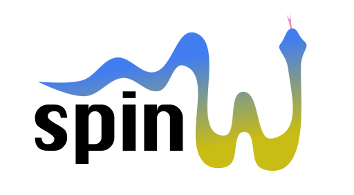

pySpinW is a tool for calculating magnon energies and simulating scattering experiments   

Details of its use can be found at www.spinw.org/pyspinw

## Example

Here is an example of calculating dispersion curves for simple ferromagnetic chain in python:

```python

from pyspinw import *

# Define the unit cell
unit_cell = UnitCell(1, 1, 1)

# Specify a magetic atom at (0,0,0), with moment (0,0,1)
x = Site(0, 0, 0, 0, 0, 1, name="X")

# Create a magnetic structure (this could include a spacegroup, or 
# supercell structure, but we don't do so here)
structure = Structure([x], unit_cell=unit_cell)

# A single exchange between atoms in neighbouring unit cells (in the x direction)
exchanges = [HeisenbergExchange(x, x, cell_offset=(1, 0, 0), j=-1)]

# Create a Hamiltonian object that holds things together 
hamiltonian = Hamiltonian(structure, exchanges)

# Define a path through q-space for out dispersion curve
path = Path([[0, 0, 0], [1, 0, 0]])

# Show the spaghetti plot, with constant energy smearing of 0.4
hamiltonian.spaghetti_plot(path, dE=0.4)

```


## New in V1.1

In going from 1.0 to 1.1 we've made a lot of improvements. 
There have been a number of name changes, most importantly, changing `LatticeSite` to `Site`. 
This will likely affect quite a lot of existing scripts, but we considered it's best
to make this change as early as possible, to minimise its impact.

Here's a summary of the main changes:

 * Tools for navigating an updating an existing crystal structure:
   * Get sites by name and/or element
   * Nearest neighbour searches
   * Finding by symmetry relations
 * A symmetry based workflow:
   * Report symmetry constraints
   * Check validity of exchanges/anisotropies 
   * Copy exchanges/anisotropies using symmetry
 * Metadata for sites: color, element, radius
 * `DirectSupercell` lets you specify spins in different cells independently
 * Updates to the viewer
   * Fixes for macOS
   * Lots more settings
   * Rendering improvements
   * Multiple copies of the viewer can run at the same time 
   * Non-interactive `snapshot` function
 * Improvements to
 * Loading and saving: CIF, TB2J, pyspinw native format (.spw), mCIF (currently limited support)
 * A new website, with new tutorials
 * Various performance improvements
 * Bugfixes:
   * Fixed an error that affected some spinwave calculations involving DM interactions
   * Viewer bug fixes
